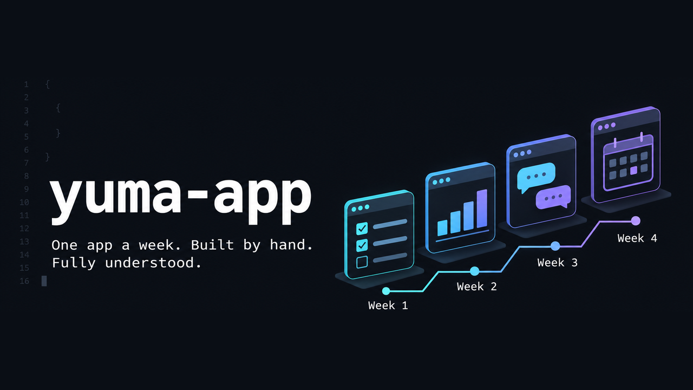
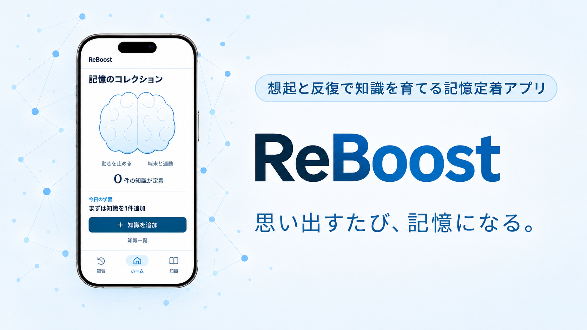

<table align="left" width="49%">
  <tr><th><h3>yuma-app</h3></th></tr>
  <tr><td align="center"></td></tr>
  <tr><td>

説明

1週間で1つのWebアプリを自力で作り、コードを理解するまで進めるチャレンジ用のリポジトリ

</td></tr>
</table>
<table align="left" width="49%">
  <tr><th><h3>ReBoost</h3></th></tr>
  <tr><td align="center"></td></tr>
  <tr><td>

説明

記憶の定着を助けるアプリ。記憶に有効な学習方法を調べ、その考え方を機能に取り入れています

</td></tr>
</table>
 

next section
