

  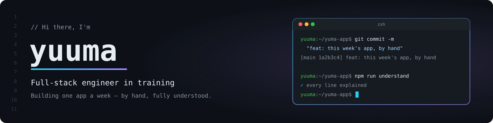

## 👋 About Me

> **「誰のどんな課題を解決するか」から考える開発**を大事にしています。

現在は、1週間で1つのアプリを自力で作り、理解まで進めるチャレンジに取り組んでいます。

- 🎯 **Goal** — フルスタックエンジニア
- 🔨 **Now** — [yuma-app](https://github.com/yu-pakku/yuma-app)：週1本のWebアプリ開発チャレンジ
- 📚 **Focus** — Next.js（App Router）／TypeScript／SQL・HTTP・Gitの基礎
- 💡 **Interest** — 情報技術の恩恵を受けにくい人を支える仕組みづくり

## 📦 Projects

### 👤 個人制作

<table>
  <thead>
    <tr>
      <th width="50%"><h3><a href="https://github.com/yu-pakku/yuma-app">yuma-app</a></h3></th>
      <th width="50%"><h3><a href="https://github.com/yu-pakku/reboost">ReBoost</a></h3></th>
    </tr>
  </thead>
  <tbody>
    <tr>
      <td align="center"></td>
      <td align="center"></td>
    </tr>
    <tr>
      <td valign="top">

説明

1週間で1つのWebアプリを自力で作り、コードを理解するまで進めるチャレンジ用のリポジトリ

</td>
      <td valign="top">

説明

記憶の定着を助けるアプリ。記憶に有効な学習方法を調べ、その考え方を機能に取り入れています

</td>
    </tr>
  </tbody>
</table>

<table>
  <thead>
    <tr>
      <th width="50%"><h3><a href="https://github.com/yu-pakku/laravel-student-app">学生データバンク</a></h3></th>
      <th width="50%"><h3><a href="https://github.com/yu-pakku/game">ボードゲーム</a></h3></th>
    </tr>
  </thead>
  <tbody>
    <tr>
      <td align="center"><a href="https://github.com/yu-pakku/laravel-student-app">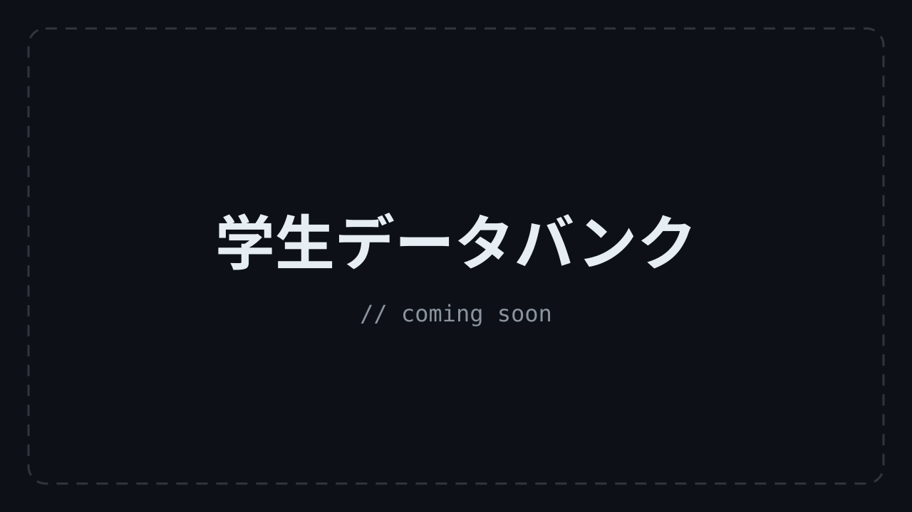</a></td>
      <td align="center"><a href="https://github.com/yu-pakku/game">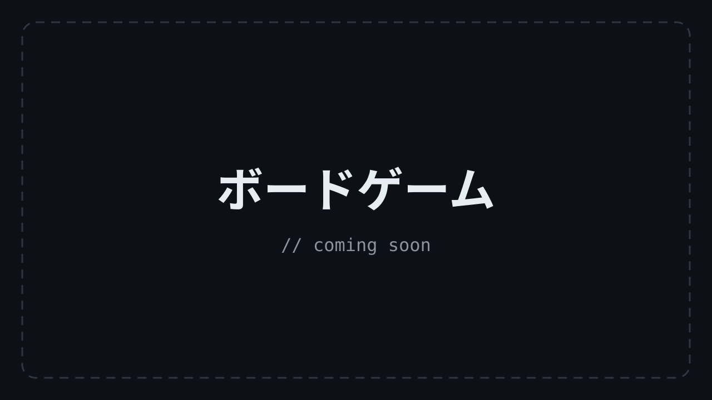</a></td>
    </tr>
    <tr>
      <td valign="top">

説明

（準備中）

</td>
      <td valign="top">

説明

（準備中）

</td>
    </tr>
  </tbody>
</table>

<table>
  <thead>
    <tr>
      <th width="50%"><h3><a href="#">インディーゲーム</a></h3></th>
      <th width="50%"><h3><a href="#">ポートフォリオ</a></h3></th>
    </tr>
  </thead>
  <tbody>
    <tr>
      <td align="center"><a href="#">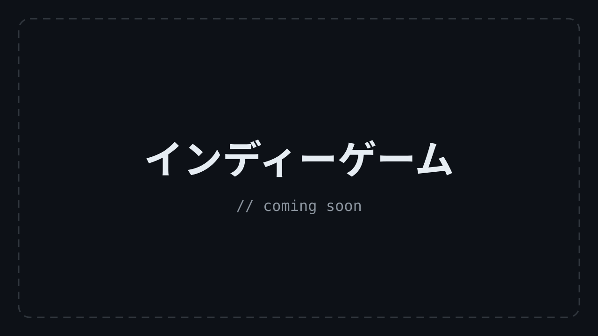</a></td>
      <td align="center"><a href="#">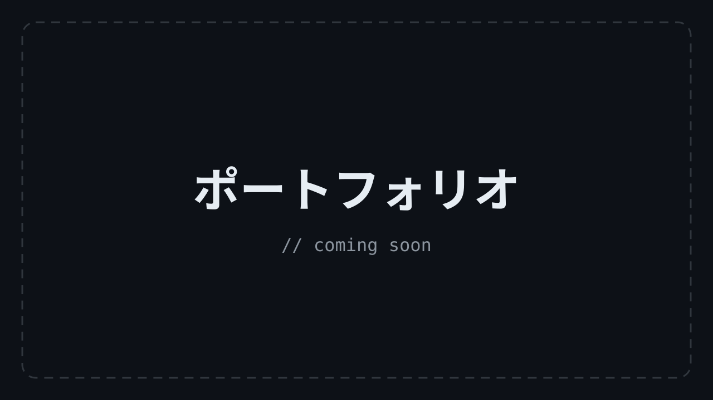</a></td>
    </tr>
    <tr>
      <td valign="top">

説明

（準備中）

</td>
      <td valign="top">

説明

（準備中）

</td>
    </tr>
  </tbody>
</table>

### 👥 チーム制作

<table>
  <thead>
    <tr>
      <th width="50%"><h3><a href="https://github.com/yu-pakku/SnapSpot">SnapSpot</a></h3></th>
      <th width="50%"><h3><a href="https://github.com/WeatherNewsApp/weather-web-frontend">Muddy</a></h3></th>
    </tr>
  </thead>
  <tbody>
    <tr>
      <td align="center"></td>
      <td align="center"></td>
    </tr>
    <tr>
      <td valign="top">

説明

（準備中）

</td>
      <td valign="top">

説明

（準備中）

</td>
    </tr>
  </tbody>
</table>

## 🛠 Tech Stack

🎓 習得済み　📖 学習中

**Frontend**

  
  
  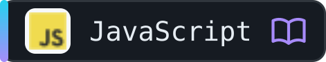
  
  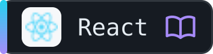
  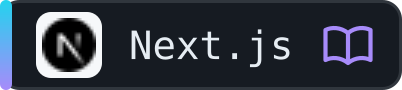
  
  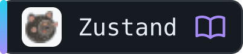
  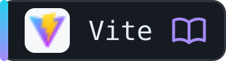

**Backend**

  
  
  
  
  
  
  
  
  

**Database**

  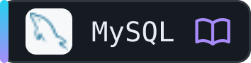
  
  
  
  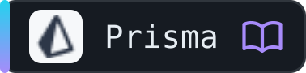
  
  

**DevOps**

  
  
  
  
  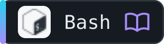

**Tools**

  
  
  
  
  
  
  
  
  

**Design**

  
  
  
  
  

