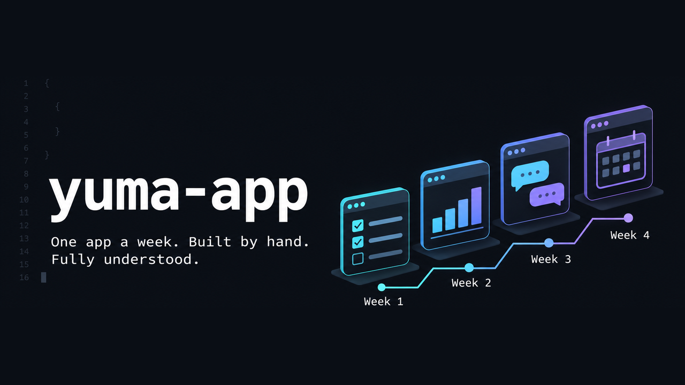
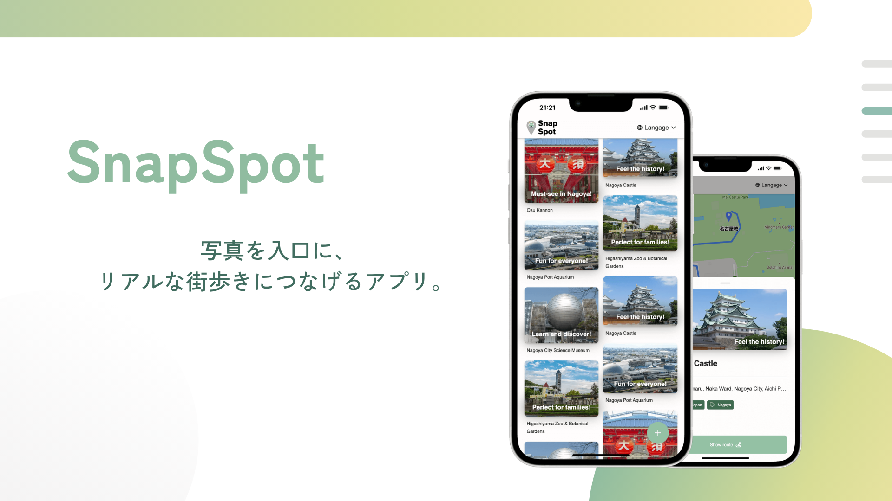

# Hi, I'm yuuma 👋

フルスタックエンジニアを目指して、Webアプリ開発を通じた学習に取り組んでいます。  
現在は「1週間で1つのアプリを自力で作り、理解まで進める」チャレンジを継続中です。

## 🔨 Current Focus
- **[yuma-app](https://github.com/yu-pakku/yuma-app)**：週1本のWebアプリ開発チャレンジ
- Next.js（App Router）と TypeScript によるフルスタック開発
- SQL・HTTP・Git など、Web開発の基礎を説明できる水準まで深めること

## 🛠 Tech Stack

**使える技術**
- HTML / CSS
- Laravel（ルーティング・マイグレーション・モデル）
- MySQL

**学習中**
- TypeScript / JavaScript
- React / Next.js
- Node.js
- Tailwind CSS
- PostgreSQL / Supabase
- Docker
- Python / PHP / SQL / シェル

## 📦 Projects

### 👤 個人制作

<table>
  <tr>
    <td align="center" valign="top">
      <h3><a href="https://github.com/yu-pakku/yuma-app">yuma-app</a></h3>
      
    </td>
    <td align="center" valign="top">
      <h3><a href="https://github.com/yu-pakku/reboost">ReBoost</a></h3>
      
    </td>
  </tr>
  <tr>
    <td align="center" valign="top">
      <h3>学生データバンク</h3>
      
    </td>
    <td align="center" valign="top">
      <h3>Game</h3>
      
    </td>
  </tr>
</table>

### 👥 チーム制作

<table>
  <tr>
    <td align="center" valign="top">
      <h3><a href="https://github.com/yu-pakku/SnapSpot">SnapSpot</a></h3>
      
    </td>
    <td align="center" valign="top">
      <h3><a href="https://github.com/WeatherNewsApp/weather-web-frontend">Muddy</a></h3>
      
    </td>
  </tr>
</table>
